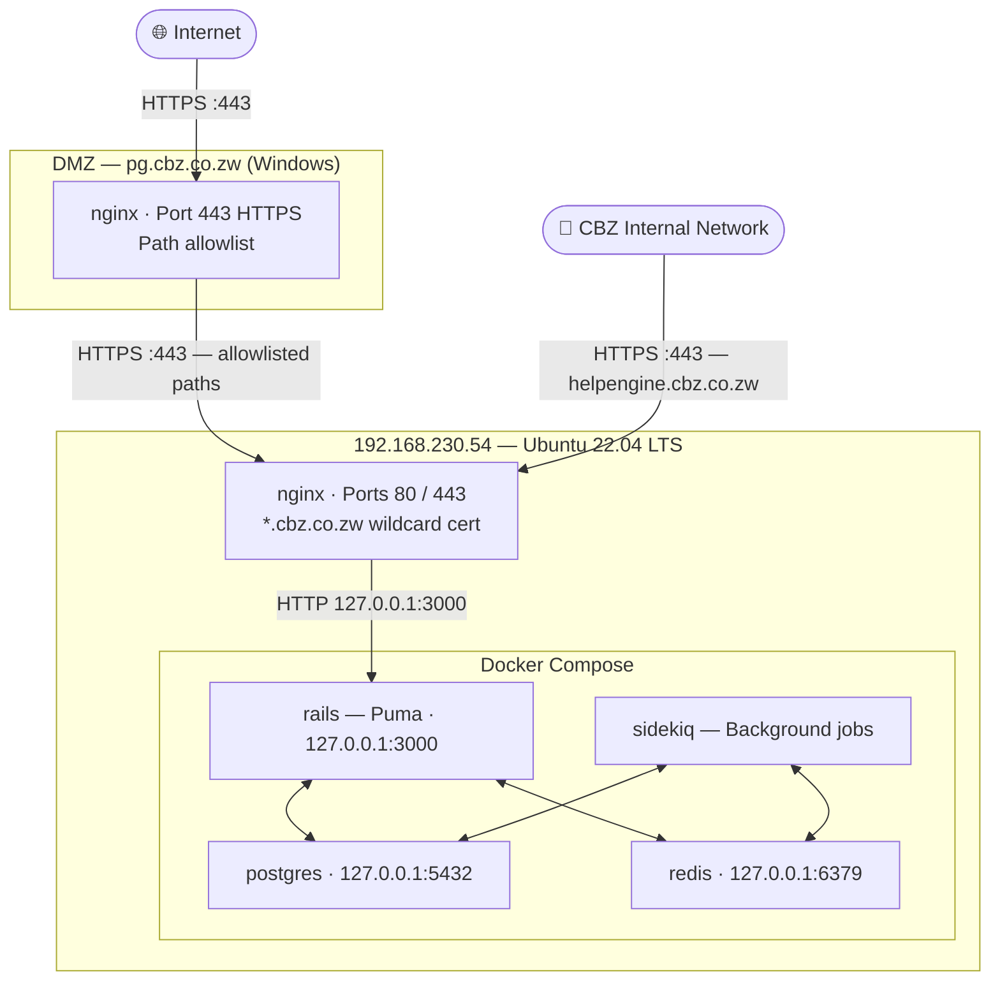

<p align="center">
  
</p>

<h1 align="center">CBZ HelpEngine</h1>
<p align="center"><strong>Deployment Guide</strong></p>
<p align="center">Internal &nbsp;·&nbsp; DevOps &nbsp;·&nbsp; CBZ IT Department</p>

---

# CBZ HelpEngine — Deployment Guide

## Architecture Overview



> Full architecture detail: [docs/ARCHITECTURE.md](docs/ARCHITECTURE.md)

| Machine | OS | CPU | Role |
|---|---|---|---|
| Dev Mac | macOS | Apple Silicon (arm64) | Build & development |
| Production server | Ubuntu 22.04.5 LTS | x86_64 (amd64) | Runs the app |
| DMZ proxy | Windows Server | x86_64 | Internet-facing nginx reverse proxy |

### Why images are built on an amd64 runner

The Dockerfile uses Alpine Linux (musl libc). Native gems like `grpc` must compile from source — pre-built binary gems
won't run on musl — and cross-compiling under QEMU emulation (arm64 Mac → amd64) exhausts Docker Desktop's memory. The
pipeline therefore builds on an amd64 GitLab runner and publishes the image to the project's container registry; the
servers only pull it. See **Pipeline** below.

---

## Prerequisites

### Dev Mac
- Docker Desktop
- `rsync` and `scp` (built into macOS)
- `openssl` (built into macOS — needed to extract certs from PFX)

### Production server
- Docker Engine + Docker Compose v2 (`docker compose` not `docker-compose`)
- nginx (`sudo apt install -y nginx`)
- SSH access (`itdevtd@192.168.230.54`)
- ~15 GB free disk space for the build

---

## First-time deployment

The application is deployed by the GitLab pipeline: prepare the host and its env files as in **Pipeline → Setting up a
host**, then release. Two things are done by hand, once per environment:

### Encryption keys (first deploy only)

Every environment needs its own three Active Record Encryption values in `deploy/env/helpengine.env` before its first
release (`scripts/check-env.sh` refuses to deploy without them). Any random strings work:

```bash
for k in PRIMARY_KEY DETERMINISTIC_KEY KEY_DERIVATION_SALT; do echo "ACTIVE_RECORD_ENCRYPTION_$k=$(openssl rand -hex 32)"; done
```

**Never change them on an environment that has data** (nor `SECRET_KEY_BASE`): encrypted columns become unreadable and
everyone is signed out. Production keeps the values it already has.

### What a new environment starts with

On a new environment's first release, the migrate step loads the schema into the empty database and seeds it
(`db/seeds.rb`, `Helpengine::Defaults`, content in `config/helpengine_defaults.yml`):

- **UserConnect sign-in is on** (SSO and the username/password form), pointed at `UC_BASE_URL` and `UC_SYSTEM_ID` from
  `deploy/env/helpengine.env` (required: `scripts/check-env.sh` refuses to deploy without them). Afterwards these live in
  Super Admin → Settings; the env file is not read again. Existing databases are never changed by this.
- **Complete the onboarding wizard straight after the first release.** Open the environment's URL: the wizard creates
  the account and the super admin (a local login, used for Super Admin). UserConnect users join that account the first
  time they sign in, so they cannot sign in before it exists.
- **The account starts with** the CBZ labels, custom attributes, canned responses, automation rules (the resolution
  rule off) and macros. Each WhatsApp inbox created afterwards starts with the integration settings: Chatwoot greeting
  off (WA-Bot-Engine sends the handoff greeting), conversations not locked, Harare working hours with an out-of-office
  reply. CSAT stays off until `FRONTEND_URL` is final (see the integration table).
- These are created only when missing and never overwrite an edit. To bring an install made before this up to date:
  `docker compose -f docker-compose.production.yaml run --rm rails bundle exec rails runner db/seeds/cbz_configs.rb`.
  It also applies the integration settings to existing WhatsApp inboxes, so it turns the Chatwoot greeting **off** where
  an earlier version of that script had turned it on.

---

## nginx setup (production server)

nginx sits in front of Puma and handles SSL termination, gzip, and request buffering.
Rails is bound to `127.0.0.1:3000` and is not directly network-accessible.

### Install nginx

```bash
sudo apt install -y nginx
```

### Install the wildcard SSL certificate

The cert is stored as a PFX file. Extract it on your Mac first:

```bash
# Password is in passcert.txt inside the cert folder
openssl pkcs12 -in wildcard_internal.pfx -clcerts -nokeys -out cbz.co.zw.crt \
  -passin pass:<password>
openssl pkcs12 -in wildcard_internal.pfx -nocerts -nodes -out cbz.co.zw.key \
  -passin pass:<password>

# Verify
openssl x509 -in cbz.co.zw.crt -noout -subject -dates
```

Copy to the server:

```bash
scp cbz.co.zw.crt cbz.co.zw.key itdevtd@192.168.230.54:~/
```

On the server, move into place:

```bash
sudo mkdir -p /etc/nginx/ssl
sudo mv ~/cbz.co.zw.crt /etc/nginx/ssl/
sudo mv ~/cbz.co.zw.key /etc/nginx/ssl/
sudo chmod 644 /etc/nginx/ssl/cbz.co.zw.crt
sudo chmod 600 /etc/nginx/ssl/cbz.co.zw.key
sudo chown root:root /etc/nginx/ssl/cbz.co.zw.*
```

### nginx site config

Create `/etc/nginx/sites-available/cbz-helpengine`:

```nginx
# HTTP → HTTPS redirect
server {
    listen 80;
    server_name _;
    return 301 https://$host$request_uri;
}

# Hide the nginx version from the Server response header (fingerprinting).
# server_tokens is only valid in http/server/location blocks, not events{} —
# add it here (or to the http{} block in nginx.conf) if not already set globally.
server_tokens off;

# Main HTTPS server
server {
    listen 443 ssl http2;
    server_name _;

    ssl_certificate     /etc/nginx/ssl/cbz.co.zw.crt;
    ssl_certificate_key /etc/nginx/ssl/cbz.co.zw.key;
    ssl_protocols       TLSv1.2 TLSv1.3;
    ssl_ciphers         HIGH:!aNULL:!MD5;
    ssl_session_cache   shared:SSL:10m;
    ssl_session_timeout 10m;
    ssl_prefer_server_ciphers on;

    # Force HTTPS on future visits and prevent protocol-downgrade/SSL-stripping.
    add_header Strict-Transport-Security "max-age=31536000; includeSubDomains" always;

    gzip on;
    gzip_vary on;
    gzip_min_length 1024;
    gzip_types text/plain text/css application/json application/javascript
               text/xml application/xml image/svg+xml font/woff2;

    # ActionCable WebSocket — must come before location /
    location /cable {
        proxy_pass          http://127.0.0.1:3000;
        proxy_http_version  1.1;
        proxy_set_header    Upgrade $http_upgrade;
        proxy_set_header    Connection "Upgrade";
        proxy_set_header    Host $host;
        proxy_set_header    X-Real-IP $remote_addr;
        proxy_set_header    X-Forwarded-For $proxy_add_x_forwarded_for;
        proxy_set_header    X-Forwarded-Proto $scheme;
        proxy_read_timeout  3600s;
        proxy_send_timeout  3600s;
    }

    # Everything else
    location / {
        proxy_pass          http://127.0.0.1:3000;
        proxy_http_version  1.1;
        proxy_set_header    Host $host;
        proxy_set_header    X-Real-IP $remote_addr;
        proxy_set_header    X-Forwarded-For $proxy_add_x_forwarded_for;
        proxy_set_header    X-Forwarded-Proto $scheme;
        proxy_read_timeout  120s;
        proxy_send_timeout  120s;
        proxy_buffer_size   128k;
        proxy_buffers       4 256k;
    }
}
```

Enable and start:

```bash
sudo ln -s /etc/nginx/sites-available/cbz-helpengine /etc/nginx/sites-enabled/
sudo rm -f /etc/nginx/sites-enabled/default
sudo nginx -t && sudo systemctl enable nginx && sudo systemctl start nginx
```

---

## DMZ nginx configuration (pg.cbz.co.zw)

The DMZ nginx runs on Windows and is internet-facing. Rather than allowlisting each
app path individually, it mounts the whole app under a single `/helpengine/` prefix
(stripped before forwarding to the production server) plus a couple of unprefixed
static-asset locations. Only the paths listed below are exposed to the internet —
all others are blocked.

**This requires `FRONTEND_URL` to include the `/helpengine` prefix** (see the env
var table above) — the app derives its router base path, API/websocket URL prefix,
and every server-generated absolute link (mailers, webhook registration URLs, the
SSO redirect target) from `FRONTEND_URL`. Setting it correctly is what makes the
app's own links line up with the DMZ's prefix-stripping.

New URLs once this is live:

| What | URL |
|---|---|
| App login | `https://pg.cbz.co.zw/helpengine/app/login` |
| WhatsApp webhook (per inbox) | `https://pg.cbz.co.zw/helpengine/webhooks/whatsapp/{phone_number}` — `{phone_number}` is the `Channel::Whatsapp` record's number, digits only, no `+` (e.g. `263771234567`); confirm the exact value per inbox under Settings → Inboxes |
| UC/Entra SSO redirect (ACS) URI | `https://pg.cbz.co.zw/helpengine/saml-callback` |

**Two things outside this repo must be updated in lockstep with this DMZ config,
or the app breaks on cutover, not just old bookmarks:**
- The WhatsApp Business webhook URL above must be registered in Meta's App
  Dashboard for each WhatsApp inbox — otherwise inbound WhatsApp messages
  stop arriving.
- The UC/Entra SSO redirect URI above must be registered for this system —
  otherwise staff SSO login breaks (there is no native login fallback for
  this deployment).

Old direct URLs (e.g. `https://pg.cbz.co.zw/app/login`) will 404 under this scheme —
only `/helpengine/...` URLs are routed once this is live.

> **WhatsApp banking deployments (WA-Bot-Engine in front):** Meta's webhook is
> registered against **WA-Bot-Engine**, not Chatwoot — the engine forwards each
> customer's traffic to Chatwoot's **internal** address while that customer has a
> live-agent session, signing every forward with the Meta app secret. The public
> `/helpengine/webhooks/whatsapp/…` URL above is therefore not called by Meta in
> this topology. The channel is `source=embedded_signup` **with** an `app_secret`
> set (both required — see the next section); do not describe it as unauthenticated.

### WA-Bot-Engine integration (CBZ WhatsApp banking)

Settings that must be exactly right, all found the hard way on 2026-08-27/28.
Each one fails **silently** — no error, no log — so verify them rather than
assume.

| Setting | Value | Why |
|---|---|---|
| Outgoing webhook URL (Settings → Integrations → Webhooks) | The engine's **prefix-free** Kestrel path: `http://192.168.3.150:5005/webhook/chatwoot` (UAT), `http://192.168.230.39:5005/webhook/chatwoot` (prod). Events: `conversation_created`, `conversation_status_changed`, `conversation_updated`. | The engine's `InternalOnlyFilter` 404s any request carrying the `/wabot…` path base, and Chatwoot cannot reach `pg.cbz.co.zw` from inside (no NAT hairpin). Before this was fixed the webhook had never delivered once. |
| Webhook secret | Copy into the engine's `Chatwoot:WebhookSecret`. | The engine verifies `X-Chatwoot-Signature` and rejects everything without it. |
| `.env` → `SAFE_FETCH_ALLOWED_INTERNAL_HOSTS` | `192.168.3.150:5005,192.168.230.39:5005` | See env table — Chatwoot's SSRF guard refuses private addresses. |
| Channel `provider_config['source']` | `embedded_signup` | Stops Chatwoot auto-re-registering the WABA webhook to **itself** (`should_auto_setup_webhooks?` is false only for embedded_signup), which would hijack all Meta traffic off the engine. Set via `rails runner` `update_column` (skips callbacks). **Coupled side effect:** it also turns ON inbound signature verification — see next row. |
| Channel `provider_config['app_secret']` | = the Meta app secret (the engine's `Meta:AppSecret`, e.g. `5b68b157…`) | Because `source=embedded_signup`, Chatwoot **401-rejects** any forward without a valid `X-Hub-Signature-256`. The engine signs each forward with `Meta:AppSecret`; if `app_secret` is unset, every forwarded receipt **and** message is rejected → read ticks stay grey and mid-session inbound never appears. |
| Channel reauthorization flag (Redis, `Reauthorizable`) | must stay **cleared** | If the inbox shows the red "disconnected / reauthorize" banner (sidebar `!`), `Webhooks::WhatsappEventsJob` bails at `channel_is_inactive?` and **silently drops EVERY forwarded webhook** — messages and receipts — while the engine still gets HTTP 200. Clear it: `Channel::Whatsapp.find_by(phone_number: "+263789352655").reauthorized!`. Prevent recurrence by setting the globals in the next row. |
| Globals `WHATSAPP_APP_ID` + `WHATSAPP_APP_SECRET` (`InstallationConfig`) | real Meta **App ID** (not the WABA id) + the app secret | Chatwoot builds a Meta app-access-token `"#{APP_ID}|#{APP_SECRET}"` for template-sync / reconnect; an empty `WHATSAPP_APP_ID` is the "WhatsApp App ID is not configured" banner and its failed calls can re-trip the reauthorization flag above. Not on the message path, but set them so nothing re-flags the channel. |
| Inbox → `lock_to_single_conversation` | **OFF** | On, every contact is pinned to one conversation forever; Chatwoot sends one CSAT per conversation, so every customer is surveyed exactly once, ever. This was the root cause of "CSAT stopped working" — 1,058 contacts, 1,058 conversations. |
| Inbox → greeting | **OFF** | WA-Bot-Engine sends the handoff greeting (personalised, with the END CHAT instruction and PIN warning). Both on = two greetings. |
| Inbox → CSAT | On, **created only after `FRONTEND_URL` is final** | The "rate us" button URL is baked into the approved template; a later sub-path move dead-ends it. Ratings then 301 to www.cbz.co.zw with no error anywhere. The API token cannot delete templates on this WABA, so each re-version leaves the old one in Business Manager. |
| Automation "Mark Pending on Resolution" | Review | Labels every resolved conversation `pending-customer` — triage noise at scale. |

#### Numbers hosted at 360dialog (`api_host: 360dialog`)

WA-Bot-Engine reaches WhatsApp only through 360dialog, so agent
replies must go through 360dialog too. A WhatsApp Cloud inbox with `provider_config['api_host'] =
'360dialog'` does that: the same Cloud API bodies go to `https://waba-v2.360dialog.io` with the
`D360-API-KEY` header, never to `graph.facebook.com` with a bearer token
(`Whatsapp::Providers::Dialog360CloudService`, `Whatsapp::Dialog360CloudApi`). Messages, templates,
media (upload and download), CSAT templates, contact-info requests, template sync and Account Health all
follow it. The legacy `default` (360dialog) provider is a different, retired API — **never** create an
inbox with it for these numbers: saving it re-registers the number's webhook to Chatwoot.

Set the channel up from `rails runner` (saving checks the key against 360dialog and refuses it if the
key belongs to another number):

```ruby
channel = Channel::Whatsapp.find_by!(phone_number: '+<number>')   # or create one, then its Inbox
channel.update!(provider_config: channel.provider_config.merge(
  'api_host' => '360dialog',
  'api_key' => '<the number\'s 360dialog API key>',
  'phone_number_id' => '<Meta phone-number id>',
  'business_account_id' => '<WABA id>',
  'source' => 'embedded_signup',
  'app_secret' => '<= the engine\'s Chatwoot:ForwardSigningSecret>'
))
```

| Setting | Why |
|---|---|
| `api_key` = the number's 360dialog key | 360dialog identifies the number from the key; no version or id goes in any path. |
| `app_secret` = the engine's `Chatwoot:ForwardSigningSecret` | 360dialog doesn't sign with Meta's app secret, so this is a secret shared by the engine and Chatwoot: the engine signs each forward with it as `X-Hub-Signature-256`, and `source=embedded_signup` makes Chatwoot verify it (401 otherwise). |
| `WHATSAPP_360DIALOG_CLOUD_BASE_URL` (optional) | Defaults to `https://waba-v2.360dialog.io`. |

What these inboxes never do: register, re-register or remove Meta's webhook (auto-setup and delete
teardown are skipped; **Register Webhook** returns an error), or offer WhatsApp calling (Graph only).
Account Health shows the number's quality, tier and status from 360dialog's `/health_status`; the WABA
name and business portfolio stay empty (360dialog has no endpoint for them). **Reconfigure** (embedded
signup) is still a Meta OAuth flow that would overwrite these settings — still never click it.

Operational notes: Puma runs single-mode (5 threads) unless `WEB_CONCURRENCY` is
set — set `WEB_CONCURRENCY=4` before any real agent load. No database backup
exists on the host as of 2026-08-28; the Postgres volume sits on the root LV.

#### UI buttons that silently break the topology — NEVER click

Each re-registers the WABA webhook at Meta to Chatwoot's own
`{FRONTEND_URL}/webhooks/whatsapp/{phone}` URL, overriding the engine and killing
all inbound WhatsApp (the exact hijack from 2026-08-28 cutover):

- **"Register Webhook"** — inbox → **Account Health** (beside Webhook Configuration) →
  `WebhookSetupService#register_callback` → `subscribe_waba_webhook(waba_id, chatwoot_url)`.
- **"Reconfigure"** — inbox → **Configuration** → WhatsApp Embedded Signup → embedded-signup re-setup.
- **"Click here to reconnect"** — the red disconnected banner → reauthorization → same re-setup.

If Meta's webhook ever gets pointed back at Chatwoot, repoint it to the engine:
`POST /{waba-id}/subscribed_apps` with `override_callback_uri=https://pg.cbz.co.zw/wabot/webhook/whatsapp`
and the engine's `Meta:VerifyToken`.

#### Health warnings that are EXPECTED — do NOT try to "fix" them

Permanent, correct side effects of running Chatwoot behind the engine:

- **Account Health → "Webhook URL mismatch"** — the health check compares Meta's registered
  callback against Chatwoot's *own* expected URL (`build_expected_webhook_url`), but Meta points
  at the engine by design, so it always shows a mismatch. This is the desired state.
- **Configuration → "WhatsApp Configuration ID is not configured"** — the global
  `WHATSAPP_CONFIGURATION_ID` only feeds the embedded-signup Reconfigure flow (not messaging).
  Leaving it unset is fine and keeps that hijack button inert.

Add these location blocks inside the `pg.cbz.co.zw` server block.

```nginx
# ── CBZ HelpEngine ─────────────────────────────────────────
# Static assets — cache aggressively. Unprefixed (no /helpengine) — Vite
# builds these paths at the domain root and the app doesn't rewrite them.
location ~* ^/(vite|assets|brand-assets|dashboard|audio|integrations)/ {
    proxy_pass          https://192.168.230.54;
    proxy_http_version  1.1;
    proxy_ssl_verify     off;
    proxy_set_header    Host              $host;
    proxy_set_header    X-Real-IP         $remote_addr;
    proxy_set_header    X-Forwarded-For   $proxy_add_x_forwarded_for;
    proxy_set_header    X-Forwarded-Proto $scheme;
    expires             7d;
    add_header          Cache-Control "public, immutable";
}

# Root-level static files
location ~* ^/(manifest\.json|sw\.js|favicon.*|apple.*|android.*|ms-icon.*|browserconfig\.xml|robots\.txt)$ {
    proxy_pass          https://192.168.230.54;
    proxy_http_version  1.1;
    proxy_ssl_verify     off;
    proxy_set_header    Host              $host;
    proxy_set_header    X-Real-IP         $remote_addr;
    proxy_set_header    X-Forwarded-For   $proxy_add_x_forwarded_for;
    proxy_set_header    X-Forwarded-Proto $scheme;
    expires             7d;
    add_header          Cache-Control "public";
}

# Everything else — HelpEngine (app, api, auth, cable, webhooks, widget,
# survey, uc/saml-callback, health, packs/sdk.js, etc.) — prefix stripped
# before forwarding, so the backend sees the same root-relative paths it
# always has. Requires FRONTEND_URL to include /helpengine (see above) so
# the app's own generated links match this prefix.
location /helpengine/ {
    proxy_pass          https://192.168.230.54;
    proxy_buffering     off;
    proxy_ssl_verify     off;
    proxy_http_version  1.1;
    rewrite ^/helpengine/(.*) /$1 break;
    proxy_set_header    Host                $host;
    proxy_set_header    X-Real-IP           $remote_addr;
    proxy_set_header    X-Forwarded-For     $proxy_add_x_forwarded_for;
    proxy_set_header    X-Forwarded-Proto   $scheme;
    proxy_set_header    Upgrade             $http_upgrade;
    proxy_set_header    Connection          $connection_upgrade;
    proxy_read_timeout  3600s;
    proxy_send_timeout  3600s;
}
```

After editing the DMZ nginx config:

```
nginx -t
nginx -s reload
```

---

## Branding

CBZ branding defaults are baked into `config/installation_config.yml` and seed the
database automatically on `db:chatwoot_prepare`. No manual steps needed on a fresh deploy.

If branding is ever lost (e.g. after a database wipe), restore it with:

```bash
cd ~/cbz-helpengine
docker compose -f docker-compose.production.yaml exec rails bundle exec rails runner "
  {
    'INSTALLATION_NAME' => 'CBZ HelpEngine',
    'BRAND_NAME'        => 'CBZ HelpEngine',
    'LOGO'              => '/brand-assets/cbz-logo.png',
    'LOGO_DARK'         => '/brand-assets/cbz-logo.png',
    'LOGO_THUMBNAIL'    => '/brand-assets/cbz-logo.png',
    'BRAND_URL'         => 'https://www.cbz.co.zw',
    'WIDGET_BRAND_URL'  => 'https://www.cbz.co.zw',
  }.each do |name, value|
    InstallationConfig.find_or_initialize_by(name: name).tap { |c| c.value = value; c.save! }
  end
  puts 'Done.'
"
```

---

## WhatsApp inbox setup

> ⚠️ **This is the STANDALONE flow (Chatwoot is the webhook endpoint).** It does **NOT**
> apply to the CBZ WhatsApp-banking deployment, where WA-Bot-Engine sits in front and owns
> Meta's webhook. In that topology steps 3–5 are wrong and **step 5 (Register Webhook) will
> hijack Meta traffic off the engine** — follow "WA-Bot-Engine integration (CBZ WhatsApp
> banking)" above instead (channel `source=embedded_signup` + `app_secret`, Meta's webhook
> registered against the engine, never click Register Webhook / Reconfigure / Reconnect).

1. Create a WhatsApp inbox in Settings → Inboxes → Add Inbox → WhatsApp Cloud
2. Enter the phone number, WhatsApp Business Account ID, API token, and verify token
3. The webhook URL shown will be `https://pg.cbz.co.zw/webhooks/whatsapp/+263...`
4. Paste that URL into the Meta developer console → WhatsApp → Configuration → Webhook
5. In the Chatwoot inbox → Account Health tab → click **Register Webhook**

**Access token expiry:** Temporary Meta tokens expire in ~24 hours. Generate a
permanent system user token via Meta Business Suite → Settings → System Users.

---

## Pipeline

`.gitlab-ci.yml` with the job logic in `scripts/ci/` (each script runs the same on a developer machine). Releases are
tags; nothing deploys from a branch push.

| Trigger | What runs |
|---|---|
| Merge request, push to `dev` or `master` | Checks: RuboCop, the specs in `scripts/ci/specs.txt` (every spec the CBZ fork changed plus the WhatsApp ones), dependency audit, image build. Nothing is published or deployed. |
| Tag `helpengine-vX.Y.Z-rc.N` on a `dev` commit | **UAT**: checks → build and publish → *migrate* (press play) → deploy → verify |
| Tag `helpengine-vX.Y.Z` on a `master` commit | **Production**: checks (the dependency audit blocks) → build and publish → *migrate* (press play; the production environment's approvers must approve) → deploy → verify |
| Run pipeline on `dev` with `ROLLBACK_VERSION` and `ROLLBACK_ENV` | Puts that environment back on a published version |

- **Versions** are the HelpEngine's own (`1.0.0`, `1.0.1`, …); the upstream Chatwoot release each build is based on is in the
  image label `zw.co.cbz.chatwoot.version` (from `VERSION_CW`). Tags carry the `helpengine-` prefix because the repository
  also holds upstream Chatwoot's `v*` tags. **Push a tag by name** (`git push gitlab helpengine-v1.0.0-rc.1`), never
  `git push --tags`, which would send all of upstream's tags to GitLab.
- **Images**: `<registry>/cbz-solutions/digitalchannels/cbz-helpengine/helpengine:<version>`, one image for rails,
  sidekiq and migrate. A published version is immutable (the build refuses an existing one); a stable release also moves
  `<major>.<minor>`. There is no `latest`. The image runs as uid 1000 on a read-only filesystem, with a health check on
  Rails' `/health`.
- **Safeguards**: a release tag must be on `dev` (UAT) or `master` (production) or the build refuses; the env files are
  checked by name before anything starts; migrations are their own approved step before the new release starts; verify
  waits up to three minutes for rails and sidekiq to be healthy on exactly this version; every release job appends a line
  (who, which job, which release, how it ended) to `deploy-audit.log` in the deploy folder.

### Releasing

```bash
# UAT: tag a dev commit
git fetch gitlab && git tag helpengine-v1.1.0-rc.1 gitlab/dev && git push gitlab helpengine-v1.1.0-rc.1
# Production: merge dev → master by merge request (a maintainer), then tag the merge commit on master
git fetch gitlab && git tag helpengine-v1.1.0 gitlab/master && git push gitlab helpengine-v1.1.0
```

Then open the pipeline: press play on `migrate_uat` / `migrate_production` (on an existing database it only migrates).
Deploy and verify follow. A failed deploy after a successful publish needs a new tag (`-rc.2`, `1.1.1`), not a re-run of
the build.

### Rolling back

CI/CD → Pipelines → **Run pipeline**, branch **`dev`** (never the tag of the version you want: an older tag's pipeline has
no rollback job), variables `ROLLBACK_VERSION=1.0.0` (or `1.1.0-rc.1` on UAT) and `ROLLBACK_ENV=uat|production`. It pulls
that version and restarts rails and sidekiq on it: nothing is built and no migration is run or undone. It refuses when
the two versions differ in migrations, in either direction (`scripts/ci/schema-guard.sh`); `ALLOW_SCHEMA_CHANGE=true`
overrides it, only if you know the schema already matches.

### GitLab settings (a maintainer or admin; settings, not files)

1. **Runners** (shell executor, the `gitlab-runner` user in the `docker` group):
   - on the UAT host, tag `helpengine_uat`: UAT jobs, the checks and the image builds (it must be amd64);
   - on the production host, tag `helpengine_prod`, **protected** so only protected refs (the release tags) reach it.
   - Merge-request checks run on the UAT runner, and a shell runner with Docker is effectively root on its host. That is
     an accepted risk while there is no separate check runner; record it if it stays.
2. **Protected tags** `helpengine-v*`: allowed to create = Developers + Maintainers (so UAT can be released), which also
   stops tags being deleted or moved.
3. **Protected environment** `production`: deploy = Maintainers, with at least one named approver. UAT needs none, but its
   jobs are audited like production's.
4. **CI/CD variables**, only where the defaults in `.gitlab-ci.yml` differ: `BUILD_RUNNER_TAG`, `UAT_RUNNER_TAG`,
   `PROD_RUNNER_TAG`, `UAT_DEPLOY_DIR`, `PROD_DEPLOY_DIR` (default `/opt/docker/cbz-helpengine`), `UAT_URL`, `PROD_URL`.
5. The container registry is enabled for the project (it is).

### Setting up a host

In the deploy folder (`/opt/docker/cbz-helpengine` by default, owned by `gitlab-runner`); the first release copies the
compose file, `scripts/check-env.sh` and the templates into it, and never touches the real env files:

```bash
sudo mkdir -p /opt/docker/cbz-helpengine/deploy/env && sudo chown -R gitlab-runner: /opt/docker/cbz-helpengine
cd /opt/docker/cbz-helpengine
# from a checkout of this repository: deploy/env/*.env.example → deploy/env/<name>.env, compose.env.example → .env
chmod 600 .env deploy/env/*.env
scripts/check-env.sh all     # names only, never values
```

| File | Holds |
|---|---|
| `.env` | Compose settings: `COMPOSE_PROFILES=bundled-db` while Postgres runs on this host, the bind address and port |
| `deploy/env/helpengine.env` | Rails, Sidekiq and migrate: secrets, database, Redis, mail, `FRONTEND_URL`, `SAFE_FETCH_ALLOWED_INTERNAL_HOSTS`, … |
| `deploy/env/redis.env`, `deploy/env/postgres.env` | The datastore passwords (must equal the ones in `helpengine.env`; the check compares them) |

### Moving the current production onto the pipeline (once)

Production today runs from `~/cbz-helpengine` (`.env` and the old compose file, image `cbz-helpengine:latest`, built on
the server by `deploy.sh`). The new compose file keeps the project name `cbz-helpengine` and the volume names, so the
first pipeline release attaches to the existing data. Do it in a quiet window:

1. **Back up first**, and copy the files off the host:
   `docker compose -f ~/cbz-helpengine/docker-compose.production.yaml exec -T postgres pg_dump -U postgres -Fc cbz_helpengine > ~/helpengine-$(date +%F).dump`
   and `docker run --rm -v cbz-helpengine_storage_data:/s -v ~/:/b alpine tar czf /b/helpengine-storage-$(date +%F).tgz -C /s .`
2. **Pin the datastores to what runs now**: `docker inspect --format '{{.Image}}' $(docker ps -qf name=cbz-helpengine-redis) $(docker ps -qf name=cbz-helpengine-postgres)`,
   then put those digests in `docker-compose.production.yaml` (`redis:alpine@sha256:…`, `pgvector/pgvector:pg16@sha256:…`)
   by merge request. Redis must not move to an older major than the data was written with.
3. **Set up the deploy folder** as above, carrying the existing values over: `deploy/env/helpengine.env` is the old
   `.env` (keep `SECRET_KEY_BASE`, the three `ACTIVE_RECORD_ENCRYPTION_*`, `POSTGRES_PASSWORD` and `REDIS_PASSWORD`
   exactly), plus `WEB_CONCURRENCY`, `SAFE_FETCH_ALLOWED_INTERNAL_HOSTS` and `UC_PORTAL_URL`; `redis.env` and
   `postgres.env` get the same two passwords; `.env` gets `COMPOSE_PROFILES=bundled-db`. Run `scripts/check-env.sh all`.
4. **Release** `helpengine-vX.Y.Z` from `master`. `migrate_production` only migrates the existing database; its `prepare`
   step also hands the uploads volume to uid 1000 once (releases before the pipeline ran as root). The deploy recreates
   rails and sidekiq from the published image and removes the old compose file's unused `base` container.
5. **Check** sign-in, an existing conversation's attachments (the volume hand-over), and a WhatsApp handoff from the
   engine.
6. **If it goes wrong**: `cd ~/cbz-helpengine && docker compose -f docker-compose.production.yaml up -d` brings back the
   old containers on `cbz-helpengine:latest`, on the same data (root still reads the handed-over uploads). Once the new
   release has run cleanly for a few days, delete `~/cbz-source`, the old image, and the old `.env` (after taking it
   offline).

### Still open

- **Production database**: Postgres runs in a container on the application host with no backup schedule. Move it to a
  database server with backups (then drop `bundled-db` from `.env` and point `POSTGRES_HOST` at it), or at least schedule
  `pg_dump` with off-host copies.
- **Audit log**: `deploy-audit.log` is append-only by convention; ship it to the central log for production.
- **UAT host**: the pipeline expects a UAT host with its own runner, deploy folder and URL (`UAT_URL`).

---

## Useful commands

In the deploy folder (`/opt/docker/cbz-helpengine`):

```bash
# View live logs
docker compose -f docker-compose.production.yaml logs -f rails

# Check container status
docker compose -f docker-compose.production.yaml ps

# Open a Rails console
docker compose -f docker-compose.production.yaml exec rails bundle exec rails console

# Stop everything
docker compose -f docker-compose.production.yaml down

# Never: `down -v` deletes the database, Redis and uploads volumes (all data)
```

---

## File locations

### Production server (`192.168.230.54`)

| Path | Purpose |
|---|---|
| `/opt/docker/cbz-helpengine/.env`, `deploy/env/*.env` | Compose settings and the containers' environment (not in the repo — back up separately) |
| `/opt/docker/cbz-helpengine/docker-compose.production.yaml` | Compose stack definition (copied by each release) |
| `/opt/docker/cbz-helpengine/deploy-audit.log` | One line per release job: who, which job, which release, how it ended |
| `~/cbz-helpengine/`, `~/cbz-source/` | The pre-pipeline install; delete once the first pipeline release has run cleanly |
| `/etc/nginx/sites-available/cbz-helpengine` | nginx site config |
| `/etc/nginx/ssl/cbz.co.zw.crt` | Wildcard SSL certificate (expires Mar 15 2028) |
| `/etc/nginx/ssl/cbz.co.zw.key` | Wildcard SSL private key |

### DMZ proxy (`pg.cbz.co.zw`)

| Path | Purpose |
|---|---|
| `C:\nginx\conf\nginx.conf` | Main nginx config containing the HelpEngine location blocks |

---

## Internal access (on CBZ network)

For internal users to access the app with a clean SSL padlock:

1. Ask IT/DNS to create: `helpengine.cbz.co.zw → 192.168.230.54`
2. Install the CBZ internal root CA on client machines (see the PDF in the cert folder)
3. Access the app at `https://helpengine.cbz.co.zw`

Without the DNS entry, internal users must use `https://192.168.230.54` directly,
which triggers a certificate warning (the wildcard cert covers hostnames, not bare IPs).
